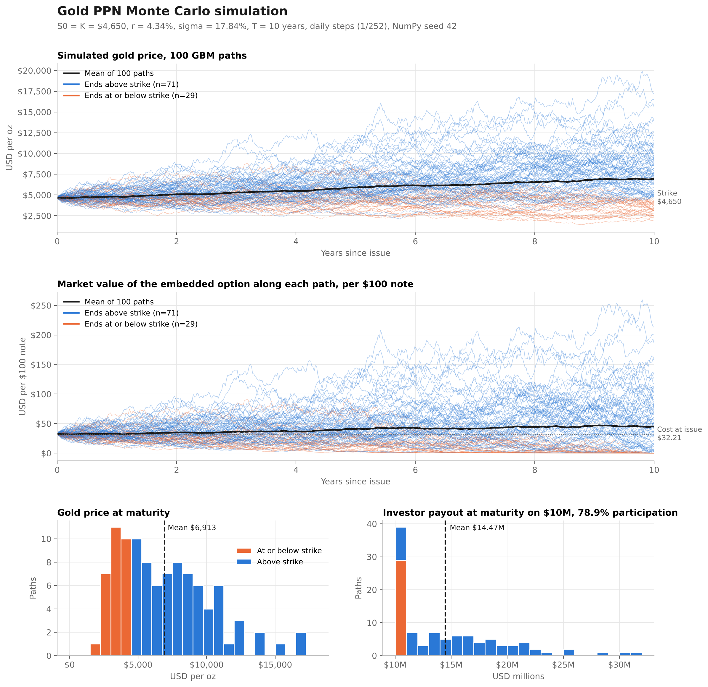

# Gold-Linked Principal Protected Note: Pricing and Analysis

Design and pricing of a $10,000,000, 10-year principal protected note (PPN) linked to the spot price of gold.
Group project for *AI in Finance*, M.A. Economics, Duke University (Spring 2026). Pricing date: April 6, 2026.

> **Academic exercise.** The assignment was to act as a bank's structured products desk pitching to a hypothetical private wealth client ("Golden Woman"). The deliverables are styled as a Goldman Sachs prospectus for that role-play only. Nothing here is affiliated with or endorsed by Goldman Sachs, and nothing here is investment advice or an offer of securities.

## The structure

Each $100 of note is split three ways at issue:

| Component | Per $100 | How it is priced |
|---|---|---|
| Zero-coupon bond (returns principal at maturity) | $64.79 | `100 · exp(−r·T)`, continuous compounding |
| Structuring fee | $3.00 | Given |
| Option budget | $32.21 | Remainder |

The option budget buys at-the-money calls on gold. A call giving 100% participation costs $40.84 per $100 (Black–Scholes), so the note can afford

**fair participation rate = 32.21 / 40.84 = 78.87%**

Payoff at maturity: `Principal × [1 + 78.87% × max(S_T / S_0 − 1, 0)]`

## Inputs

| Input | Value | Source |
|---|---|---|
| Spot and strike, S₀ = K | $4,650 / oz | Team input for the pricing date |
| Risk-free rate, r | 4.34% | 10-year US Treasury yield |
| Volatility, σ | 17.84% | 5-year mean of the CBOE Gold ETF Volatility Index (GVZ) |
| Maturity, T | 10 years | |
| Fee | 3% | |
| Coupon, dividend yield | none | |

## Results

| Item | Result |
|---|---|
| Fair participation rate | **78.87%** |
| Participation at stressed volatility (σ = 37.04%, the GVZ reading on the pricing date) | 57.34% |
| Fair cap if participation is raised to 100% | +138.8% |
| Monte Carlo, 100 GBM paths, seed 42 | 71 paths finish above the strike, 29 at or below |
| Gold price at maturity | mean $6,913, median $6,496, range $1,966 to $17,180 |
| Investor payout on $10M | minimum $10,000,000, mean $14,469,969, maximum $31,253,408 |
| Alternative structure proposed | Quanto Gold PPN: principal protected in USD, gold appreciation measured in EUR |

Volatility sensitivity of the participation rate (option budget held fixed):

| σ | 15% | 17.84% | 20% | 25% | 30% | 35% | 37.04% |
|---|---|---|---|---|---|---|---|
| Participation | 82.85% | 78.87% | 75.88% | 69.42% | 63.82% | 59.06% | 57.34% |



## Repository layout

| Folder | Contents |
|---|---|
| [`deliverables/`](deliverables/) | Final deliverables: the prospectus (PDF, 14 pages) and the presentation (PPTX, 15 slides) |
| [`pricing_model/`](pricing_model/) | Excel pricing workbook: Overview, Sensitivity, Sources, Summary |
| [`monte_carlo/`](monte_carlo/) | Simulation script, chart, per-path results at maturity, monthly option-value paths, run log |
| [`verification/`](verification/) | Independent re-computation of the pricing, participation rate, cap, sensitivity table and GVZ statistics |
| [`data/`](data/) | GVZ daily series from FRED (`GVZCLS`) |

## Reproduce

Requires Python 3.

```bash
pip install -r requirements.txt
```

```bash
python verification/pricing_verification.py
```

```bash
cd monte_carlo && python gold_ppn_monte_carlo.py
```

The verification script uses only the standard library and prints the numbers in `verification/verification_output.txt`. The simulation script writes its chart and two CSV files to the current directory and prints the numbers in `monte_carlo/monte_carlo_output.txt`.

## Notes on the numbers

- **Rounding.** The report and slides quote payouts at a rounded 78.9% participation (mean $14,471,617), a few thousand dollars from the figures above.
- **Simulation size.** 100 paths were required by the assignment. With so few paths the sampling error is large: the discounted mean option payoff is $28.96 per $100 against the model value of $32.21. The chart shows the spread of outcomes; it does not validate the price.
- **Quanto alternative.** The 65–72% participation range quoted for the quanto structure is an estimate, not a priced result.
- **Model limits.** Pricing assumes geometric Brownian motion with constant volatility and rates, and ignores issuer credit risk.

## Use of AI

The course required building the analysis with large language models and documenting the prompts. The prompts are at the end of the prospectus.
